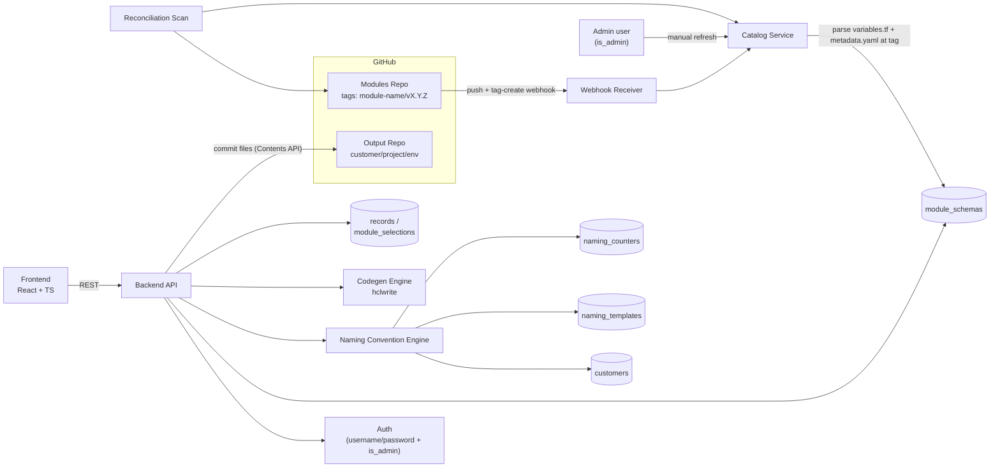
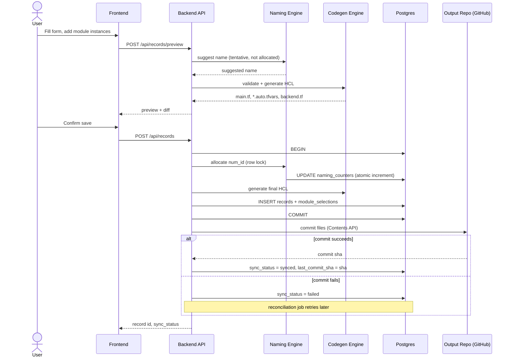

# tf-automation — Phased Implementation Plan

## Revision note (2026-09-30)
This revision adds: per-service tfvars, tag-based module versioning (monorepo path-scoped tags), admin-only manual catalog refresh, a `PROGRESS.md` tracked at the end of every phase, an org-wide naming-convention engine, architecture + transaction-flow diagrams, and a change to execution order — **Phase 0 → 1 → 3 now, Phase 2 on hold**. Superseded details from the prior revision are replaced in place below, not left as stale alternatives.

## Context

Today, Terraform usage in this org relies on engineers hand-writing HCL and running `terraform apply` from their laptops against a single repo with no pipeline or guardrails. `tf-automation` replaces the "write HCL by hand" step with a **self-service web portal**: users pick from a catalog of pre-built, multi-cloud Terraform modules, fill out generated forms for each one, and the system produces correct, ready-to-apply `.tf`/`.tfvars` code — without anyone hand-writing HCL or risking syntax/escaping mistakes.

Key constraints driving the design:
- Modules are **multi-cloud** (AWS/Azure/GCP mixed in one modules repo) — nothing can assume a single provider.
- Users select **multiple modules** and **multiple instances of the same module** (e.g. 2 VMs with different configs) per submission.
- Submissions are **records** users can revisit and edit later, each with a **globally unique ID**.
- Output is organized under `customer-name/project-name/env-name/` and must be **pullable later** by a person or automation tool — this is why output lands in git, not just a database blob.
- Both the service list and its input forms are **driven by the modules themselves** (schema derived from each module's `variables.tf`), not hand-maintained, to avoid drift.

This document is the full plan. `CLAUDE.md` at the project root carries a lean summary (Locked Decisions only) that's auto-loaded into every Claude Code session; this file is the detailed reference, read on demand. `plan/` is also the durable home for any future `/plan` sessions' finalized documents, and `plan/PROGRESS.md` tracks phase completion.

## Locked Decisions (single source of truth)

| Area | Decision |
|---|---|
| Backend language | Go, using `github.com/hashicorp/hcl/v2` (`hclparse` + `hclwrite`) for all HCL parsing/generation — guarantees syntactic validity and closes string-escaping injection risk |
| Frontend | React + TypeScript, schema-driven forms |
| Database | PostgreSQL |
| VCS | GitHub, for both the modules (input) repo and the generated-code (output) repo |
| GitHub credentials | GitHub App (free to register; higher rate limits and finer-grained permissions than a PAT) |
| Record model | One record = one `customer/project/env` combination = one future Terraform state, containing all its selected module instances |
| Multi-instance codegen | Single module block per module type, `for_each` over a map/list variable — not repeated blocks |
| tfvars structure | **Per-service**: one `<module_name>.auto.tfvars` file per selected module type within a record (not one combined file). Terraform auto-loads `*.auto.tfvars`, so no `-var-file` chaining is needed at apply time |
| Module discovery | Hybrid: variable schema auto-extracted from `variables.tf`; UI metadata from a required `metadata.yaml` per module |
| Module versioning | **By git tag**, not commit SHA. Tagging convention: `<module-name>/vX.Y.Z` (monorepo, path-scoped tags — a tag applies to one module; `<module-name>` is the module's folder path under `modules/`, e.g. `compute/instance/v1.0.0`; the tag may also include the modules directory, `modules/compute/instance/v1.0.0`, and both forms name the same module). A module with no such tag is excluded from the catalog until it has one. Each instance pins the exact tag used at submission time (`?ref=<module-name>/vX.Y.Z` in generated `module.source`) |
| Catalog refresh | Primary: GitHub webhook on push to the modules repo **and on tag creation** (`create` events, `ref_type=tag`). Fallback 1: periodic reconciliation scan (catches missed/failed webhook deliveries — GitHub doesn't guarantee delivery). Fallback 2: **manual "refresh catalog" action, visible to admin users only** (gated by a lightweight `users.is_admin` flag in Phase 1, superseded by Phase 3's full role model) |
| Naming convention | Org-wide, opt-in per module: `metadata.yaml` may declare a `naming_resource_type`; when present, the Naming Convention Engine computes a compliant resource name from an admin-managed template (tokens: `business_short_code`, `env`, `project`, `user_label`, `num_id`) and pre-fills it as the module's designated name variable — **editable by the user, not locked**. Templates are DB-backed and admin-editable via UI. `business_short_code` is captured once per customer in a `customers` registry and reused across that customer's records. The `num_id` token is a per-`(business_short_code, env, resource_type)` auto-incrementing counter, zero-padded to a configurable width (default 2 digits); allocation happens atomically at save time (not preview), and exhausting the width (e.g. passing 99 at width 2) rejects the save with a clear error rather than silently overflowing |
| Progress tracking | `plan/PROGRESS.md` is updated at the end of every phase (and, within Phase 1, as each workstream completes) with status, completion date, and a short summary — so any future session can see what's done without re-deriving it |
| Execution order | Building **Phase 0 → 1 → 3 now; Phase 2 (execution/apply) is on hold**, not cancelled — picked up later once there's a real need to run `plan`/`apply`. Phase 3's role model is designed to also gate Phase 2's future approve/apply actions once that phase resumes |
| Preview UX | Generated code (and diff, on edits) shown before final save; preview and save share one code path, guaranteeing byte-parity |
| Sensitive variables | Included in generated `terraform.tfvars` for Phase 1, with a clear UI warning at preview time. Proper exclusion/secrets-manager handling is deferred and explicitly revisited in Phase 2 |
| State backend | Self-hosted GCS/S3 (not Terraform Cloud), selected via a `STATE_BACKEND` config toggle so it can be swapped later without an engine rewrite |
| Record deletion | Soft-delete in DB only — output repo files are **never** auto-removed, to avoid destroying infra-as-code for an environment that may already be applied outside the app's knowledge. Explicit file removal would be a separate, deliberately confirmed action, not built in Phase 1 |
| Auth (Phase 1) | Simple built-in username/password login; SSO/RBAC deferred to Phase 3 |
| Execution scope (Phase 1) | Generate + store only. No `terraform plan`/`apply` runs in this phase — that's Phase 2 |

## Phase Overview

| Phase | Goal | Depends on | Status |
|---|---|---|---|
| 0 — Bootstrap & Shared Contracts | Repo scaffold, `CLAUDE.md`, and the interface contracts that let Phase 1's workstreams run in parallel | Nothing | **Building now** |
| 1 — Code Generation & Storage (MVP) | Users generate correct, storable Terraform code via a self-service UI | Phase 0 | **Building now** |
| 3 — Access Control & Governance | Move off shared login to real identity, roles, and audit | Phase 1 (not Phase 2 — its approval-gating role still applies once Phase 2 resumes, but Phase 3 doesn't need to wait for it) | **Building now** |
| 2 — Execution & Approval | Generated code can actually be plan'd/applied, with a human gate | Phase 1 complete; state bucket provisioned; execution credentials strategy decided | **On hold** — resume when there's a concrete need to run plan/apply |
| 4 — Operational Maturity | Drift detection, cost visibility, policy enforcement at scale | Phase 2 (needs plan/apply to hook into); benefits from Phase 3's role scoping | Not started |

Rows are listed in **build order** (0 → 1 → 3), not numeric order — Phase 2 keeps its original number since the roadmap's shape hasn't changed, only the near-term sequencing has. Each phase is self-contained: a team could stop after any phase and have a working, coherent system. Phase 1 itself is further broken into **parallel workstreams** (below) so multiple engineers/agents can build simultaneously against shared contracts and consolidate at the end — the same pattern should be reapplied when Phase 2 (later) and Phase 4 begin.

`plan/PROGRESS.md` tracks completion status and dates for every phase — updated as the last step of each phase (and, within Phase 1, as each workstream finishes).

---

## Phase 0 — Bootstrap & Shared Contracts

### Goal
Stand up the repo skeleton and — critically — freeze the *interfaces* between Phase 1's workstreams so those workstreams can be built in parallel without blocking on each other's implementation details.

### Deliverables
- Repo scaffold: `backend/` (Go modules per workstream package), `frontend/`, `db/migrations/`, `plan/`. **(done)**
- `CLAUDE.md` at project root containing the Locked Decisions table above and a pointer to `plan/ARCHITECTURE.md`. **(done)**
- `plan/ARCHITECTURE.md` containing the full phased plan. **(done — this file)**
- `plan/PROGRESS.md` initialized with all phases listed as "Not started" — updated at the end of every phase (and, within Phase 1, after each workstream) with status, completion date, and a short summary. **(done)**
- **`VarSchema` contract**: the normalized JSON shape a parsed module variable takes (name, type, default, description, sensitive, nullable, validations) — frozen so WS-B (parser) and WS-C (codegen engine) and WS-H (frontend) can all build against it independently, before WS-B's real parser is done, using fixture JSON.
- **OpenAPI spec** for the full API surface (see Phase 1 API section) — frozen so WS-H (frontend) can build against a generated mock server, and WS-G (backend orchestration) has an explicit contract to implement against.
- DB migration tooling choice (e.g. `golang-migrate`) and initial empty migration structure.
- GitHub App registered in the org (needed by WS-D and WS-E for real credentials; workstreams can still develop against mocks before this lands).
- CI skeleton: one pipeline stage per workstream (lint + unit test), so each workstream gets fast independent feedback.

### Exit criteria
- `VarSchema` and OpenAPI contracts are committed and reviewed — no workstream should need to guess a shape.
- A fixture `VarSchema` JSON file exists so WS-C and WS-H can start immediately without waiting on WS-B.
- A mock server generated from the OpenAPI spec runs and WS-H can point its dev build at it.
- GitHub App is registered with correct minimal permissions (read on modules repo, contents read/write on output repo) — actual key wiring can land slightly later without blocking other workstreams.
- CI runs (even if trivially) on an empty scaffold for every workstream package.
- `plan/PROGRESS.md` exists and is updated marking Phase 0 complete, with the date.

### Dependencies
None — this is the true first step.

### Risks & mitigations

| Risk | Mitigation |
|---|---|
| Contracts frozen too early get it wrong, forcing rework across all workstreams | Keep `VarSchema` and the OpenAPI spec intentionally minimal-but-complete for Phase 1's known feature set (not speculative future fields); changes are still possible, just coordinate as a versioned contract bump communicated to all workstreams rather than a silent edit |
| GitHub App registration blocked on org admin approval | Not a hard blocker — WS-D/WS-E can develop and test against a throwaway test org/repo with a temporary App or even a PAT, swapping to the real App's credentials at consolidation time |

---

## Phase 1 — Code Generation & Storage (MVP)

### Goal
An engineer can log in, pick one or more Terraform modules from a live catalog, fill out generated forms (including adding multiple instances of the same module), preview the exact code that will be produced, save it, and later reopen and edit that submission — with the generated `.tf`/`.tfvars` committed to a git repo ready for a human or automation to pull and run Terraform against. **No plan/apply happens in this phase.**

### Execution model: parallel workstreams → consolidation

Once Phase 0's contracts exist, the following workstreams can proceed **in parallel**, each independently testable, then get wired together in a final **Consolidation** step.

| Tier | Workstream | Scope | Depends on | Produces (for others) |
|---|---|---|---|---|
| 1 | **WS-A: Data Layer** | Postgres schema/migrations, repository access functions for `records`, `module_selections`, `module_schemas`, `users`, `customers`, `naming_templates`, `naming_counters` | Phase 0 (migration tooling choice) | DB schema + typed access functions used by WS-D, WS-I, WS-G |
| 1 | **WS-B: Schema Parser** | `variables.tf` → `VarSchema[]` via `hclparse` + `typeexpr`, parsed at a specific module git tag; fixture-driven unit tests | Phase 0 (`VarSchema` contract) | Parser library consumed by WS-D |
| 1 | **WS-C: Codegen Engine** | `(VarSchema + resolved values) → HCL bytes` via `hclwrite`; renders root `variables.tf`, `main.tf`, **one `<module_name>.auto.tfvars` per selected module**, one-time `backend.tf`; golden-file + fuzz tests | Phase 0 (`VarSchema` contract; can build against fixture JSON, doesn't need WS-B's real parser) | Codegen library consumed by WS-G |
| 1 | **WS-E: Output Repo Integration** | GitHub Contents API client: commit-or-update files at a path, `sync_status`/`last_commit_sha` handling, conflict/retry logic | Phase 0 (GitHub App or interim PAT) | Commit client consumed by WS-G |
| 1 | **WS-F: Auth** | Username/password login, session/JWT middleware, basic login rate-limiting, **lightweight `is_admin` flag** (gates manual catalog refresh only — not full RBAC, which is Phase 3's job) | Phase 0 (scaffold) | Auth middleware consumed by WS-G |
| 1 | **WS-H: Frontend** | Catalog browser, dynamic per-module forms (locked/edit-toggle), multi-instance add/remove, customer/project/env fields, **naming-convention-suggested name field (editable)**, preview/diff screen, record list + edit, **admin-only "refresh catalog" button** | Phase 0 (OpenAPI mock server) | UI, integrated against the real API at consolidation |
| 2 | **WS-D: Catalog Service + Webhook** | Orchestrates WS-B's parser + `metadata.yaml` loading across the modules repo, **scoped to tagged module versions (`<module-name>/vX.Y.Z`)**; webhook receiver for push + tag-create events (HMAC-verified); periodic reconciliation scan; **admin-triggered manual refresh endpoint** | WS-A (schema cache table), WS-B (parser interface — can start against a stub parser, swap in WS-B's real implementation when ready) | Catalog data consumed by WS-G |
| 2 | **WS-I: Naming Convention Engine** | Given `(business_short_code, env, project, user_label, resource_type)`, resolves the admin-defined template, atomically allocates the next `num_id` (row-locked, rejects past the configured width), returns the computed name; admin endpoints for managing `naming_templates` and the `customers` registry | WS-A (`customers`, `naming_templates`, `naming_counters` tables) | Suggested-name computation consumed by WS-G/WS-H |
| 2 | **WS-G: Backend API orchestration** | REST handlers wiring A+B/D+C+E+F+I together: catalog endpoints (incl. admin refresh), preview/create/update/list record endpoints, naming-template/customer admin endpoints, webhook route mounting | WS-A, WS-C, WS-E, WS-F directly; WS-D, WS-I once ready (scaffolds early against mocks of all of the above per the OpenAPI contract, swaps in real implementations as they land) | The real API WS-H integrates against |
| 3 | **Consolidation** | Replace every mock/stub with the real workstream output; run the full verification suite; manual end-to-end milestone; update `plan/PROGRESS.md` | All of the above | Phase 1 sign-off |

This ordering means 6 of 9 workstreams (A, B, C, E, F, H) can start on day one of Phase 1 with zero inter-workstream blocking, since they only depend on Phase 0's frozen contracts. D, I, and G have soft dependencies that are satisfied by mocking against the same contracts until the real pieces land.

### Feature list

**MVP (ship in Phase 1):**
- Module discovery from `modules/<path>/{variables.tf, metadata.yaml}` convention (nested paths allowed), versioned via `<module-name>/vX.Y.Z` git tags
- Webhook-driven catalog refresh (push + tag-create events) + periodic reconciliation fallback + **admin-only manual refresh button** (gated by `users.is_admin`; not shown to normal users)
- Multi-module selection per record
- Multi-instance support per module (`for_each`-based codegen, unique instance names enforced structurally)
- Dynamic forms: required vars editable, default-valued vars locked with an edit toggle
- Customer/project/env fields driving output path + record identity
- **Customers registry**: `business_short_code` captured once per customer, reused automatically on later records for that customer
- **Naming Convention Engine**: for modules whose `metadata.yaml` declares a `naming_resource_type`, computes a compliant name from an admin-managed template and pre-fills it as an editable default (locked-vs-editable analog to the default-value field UX)
- Preview/diff of generated code before save (byte-identical guarantee)
- Record CRUD with UUID identity; edit reloads exact original module version via pinned schema
- Module version pinning by git tag (`?ref=<module-name>/vX.Y.Z` in generated `module.source`)
- **Per-service tfvars**: one `<module_name>.auto.tfvars` per selected module within a record (Terraform auto-loads these — no `-var-file` chaining needed)
- One-time `backend.tf` generation (self-hosted GCS/S3), not overwritten on routine edits
- Output repo commits via GitHub Contents API with `sync_status`/`last_commit_sha` tracking + retry
- Reconciliation job for records stuck in `sync_status=pending` past a timeout (process crash between DB commit and git push)
- Optimistic concurrency on record edits (409 on stale writes)
- Sensitive-variable UI warning (values still included in tfvars — locked decision)
- Simple built-in username/password auth, with basic login rate-limiting, and a lightweight `is_admin` flag (catalog refresh + naming-template/customer management only — not full RBAC)
- Soft-delete for records (output files untouched — locked decision)
- `plan/PROGRESS.md` updated at the end of Phase 1 (and after each workstream)

**Explicitly deferred (not in Phase 1):**
- Any `terraform plan`/`apply` execution → Phase 2 (on hold)
- Approval workflows → Phase 2 (on hold)
- Full RBAC / SSO → Phase 3 (building now, right after Phase 1)
- Secrets excluded from tfvars / secrets-manager integration → Phase 2+
- Drift detection, cost estimation, policy-as-code → Phase 4
- Deep (>2 level) nested object-type forms → falls back to raw JSON textarea in Phase 1
- Explicit "delete output files" action → not built in Phase 1 (soft-delete only); would be a deliberate future action if ever needed
- A UI to pick among multiple available tags for a module (Phase 1 pins to the latest tag at time of selection only)
- Reclaiming/reusing `num_id` values from deleted records (counters are monotonic, never reused)

### Exit criteria
- A test modules repo with 3+ representative multi-cloud modules is fully cataloged and browsable in the UI.
- A user can create a record selecting 2 module types (one with 2 instances), see an accurate preview, save it, and find the commit in the output repo at the expected path.
- Reopening and editing that record repopulates the form correctly (including per-instance values) and produces a correct diff before re-saving.
- `terraform init -backend=false && terraform validate` passes against generated output for every test-fixture module combination exercised in CI.
- Golden-file and round-trip fuzz tests for the codegen engine pass (adversarial strings don't break generated HCL).
- Catalog reflects a modules-repo push within the webhook processing window; a deliberately dropped webhook is still caught by the next reconciliation scan.
- A record save that fails to commit to GitHub leaves `sync_status=failed` (never silently lost) and can be retried successfully; a process killed mid-save is caught by the stuck-`pending` reconciliation job.
- Deleting a record marks it inactive in the DB while its output repo files remain untouched and byte-identical to before the delete.
- A module with a `naming_resource_type` produces a correctly computed, editable suggested name; two instances requesting the same `(business_short_code, env, resource_type)` get sequential `num_id` values with no collision under concurrent saves.
- A normal user does not see the manual catalog-refresh control; an admin user does, and using it re-parses the catalog on demand.
- Every workstream's own unit tests pass independently in CI before Consolidation begins; Consolidation's own end-to-end suite passes after wiring.
- `plan/PROGRESS.md` reflects Phase 1 as complete, with date and a summary of what shipped.

### Dependencies
Phase 0's contracts and repo scaffold. To *finish*: a GitHub App registered with access to both the modules repo and a new output repo; a provisioned Postgres instance; agreement on the bucket-naming convention for the self-hosted state backend referenced in generated `backend.tf` (the bucket itself doesn't need to exist yet since no apply happens in this phase).

### Edge cases (by category)

**Catalog / schema parsing**
| Scenario | Handling |
|---|---|
| Module folder has `variables.tf` but no `metadata.yaml` (or vice versa) | Skipped and flagged in an admin view; catalog refresh continues for other modules, doesn't fail wholesale |
| `variables.tf` has an HCL syntax error | Module flagged as invalid with the parse error surfaced; excluded from the catalog until fixed |
| `metadata.yaml`'s `name` field doesn't match its folder name | Validation error at catalog build time, module excluded and flagged |
| Two modules declare the same `metadata.yaml` `name` | Validation error at catalog build time; both flagged, neither silently wins |
| Module has zero `variable` blocks | Still cataloged; renders as a zero-field form (module with only defaults/no inputs) |
| Variable type is an unsupported/exotic HCL type expression | Falls back to a raw-JSON field in the UI rather than failing catalog parse entirely |
| Module renamed or deleted upstream | `is_latest` flips to false / row removed from active catalog for *new* selections; already-saved records still resolve correctly via their pinned tag + cached `module_schemas` row |
| Non-module folders under `modules/` (README, `.github/`, etc.) | Not misidentified — the "must contain both `variables.tf` and `metadata.yaml`" rule naturally excludes them |
| GitHub webhook delivery missed or fails | Periodic reconciliation scan (e.g. hourly full diff against modules repo HEAD) catches drift the webhook missed |
| Webhook fires for a push to a non-tracked branch (e.g. a PR branch) | Receiver only reacts to pushes on the configured tracked ref (e.g. `main`) |
| Duplicate/replayed webhook delivery | Dedup by GitHub's delivery ID before reprocessing |

**Forms / UI**
| Scenario | Handling |
|---|---|
| User leaves a required variable blank | Client-side validation blocks preview/save; server re-validates authoritatively regardless |
| User types the same instance name twice for one module | Blocked client-side on add; server re-validates and rejects on submit as the authoritative check |
| Instance name uses characters unsafe for HCL map keys or downstream cloud resource naming | Validated against an explicit allowed charset/length (e.g. lowercase alphanumeric + hyphens, ≤63 chars) before it can reach codegen |
| Customer/project/env name collides after slugification (e.g. "My Project" vs "my-project") | DB `UNIQUE` constraint on the slugified `output_path` is the authoritative guard; API translates the resulting constraint violation into a friendly "this env already exists, did you mean to edit it?" error rather than a raw 500 |
| Form value type mismatch (HTML form gives a string for a `number`-typed variable) | Backend coerces/validates against the variable's `cty` type before generation, rejecting mismatches with a clear error rather than silently generating wrong HCL |
| A module's `validation` blocks (from `variables.tf`) | Surfaced as UI help text for guidance; server-side Terraform-shaped type/shape checking is the authoritative check — client-side duplication of the condition itself is not required for Phase 1 |

**Codegen**
| Scenario | Handling |
|---|---|
| Record submitted with zero module instances | Disallowed — at least one module instance is required to save a record |
| User clicks "update to latest module version" on an existing record | Re-fetches the current `is_latest` schema, re-validates existing instance values against it, and explicitly prompts for any newly-required fields rather than silently generating incomplete code |
| Complex default values (objects/maps) in a variable | Rendered via `hclwrite`'s typed value encoding, same as user-supplied values — no separate code path for defaults |
| Very long or unicode-heavy string values | Covered by the same `hclwrite` encoding; included explicitly as a fuzz-test case |
| Pinned module tag no longer exists (e.g. tag deleted/force-moved after being used) | Known limitation, not solved in code — recommend the modules repo treat tags as immutable once published (never delete/retag) as an operational safeguard |
| Module has commits but no `<module-name>/vX.Y.Z` tag yet | Excluded from the catalog (same treatment as a missing `metadata.yaml`) — flagged in the admin view as "no released version" rather than silently using an unpinned ref |
| Module has multiple tags | Phase 1 pins to the latest tag (by semver, not by tag-creation date) at time of selection; no version picker UI in Phase 1 |

**Naming convention**
| Scenario | Handling |
|---|---|
| Module's `naming_resource_type` has no matching `naming_templates` row | Form shows a clear "no naming template configured for this resource type" message and falls back to a plain editable name field, rather than blocking module selection entirely |
| Customer has no `business_short_code` set yet | Blocked with a clear "this customer needs a business short code configured" error before the naming engine is invoked; resolved via the admin customers-registry endpoint |
| Template references an unknown token (e.g. `{typo_token}`) | Rejected at template save time (admin-side validation), not at generation time |
| Two concurrent saves both need the next `num_id` for the same `(business_short_code, env, resource_type)` | Allocation is a row-locked atomic increment inside the save transaction (not at preview time), so no two saves can receive the same value |
| `num_id` would exceed the configured width (e.g. 100 at width 2) | Save is rejected with a clear error naming the exhausted counter; preview still works (it shows a tentative, non-committed suggestion) so the user isn't surprised only at save time |
| User edits the auto-suggested name | Allowed — the computed name is a default, not enforced (locked decision); the edited value is stored and used as-is |
| Record deleted (soft-delete) | Its allocated `num_id` is **not** reclaimed — counters are monotonic to avoid a freed number being reused while remnants of the old resource might still exist in the target cloud |

**Storage / consistency**
| Scenario | Handling |
|---|---|
| Process crashes between DB commit and git push | Record stays `sync_status=pending`; reconciliation job scans for `pending` rows older than a timeout and retries or surfaces for manual retry |
| Race between two requests for the same new `(customer, project, env)` | DB `UNIQUE` constraint is the real guard (not a pre-check-then-insert), with the resulting conflict translated into a friendly error |
| GitHub API rate limiting under load | GitHub App credentials (vs PAT) give materially higher limits; requests use backoff/retry regardless |
| Output repo file was manually modified outside the app | Contents API's SHA-based conditional update fails; app refuses to overwrite and surfaces `sync_status=failed` with an explicit "output was modified outside the app" message, rather than silently clobbering manual changes |

**Security**
| Scenario | Handling |
|---|---|
| Any authenticated user can edit any record | Explicitly accepted as a known Phase 1 limitation (no RBAC yet) — documented, not an oversight; resolved in Phase 3 |
| Brute-force login attempts | Basic rate-limiting on `/api/auth/login` in Phase 1 |
| GitHub App credentials at rest | Stored via environment/secrets store, never committed — an operational note for deployment, not application logic |

### Risks & mitigations

| Risk | Mitigation |
|---|---|
| HCL injection/escaping via user-supplied strings | All values pass through `hclwrite`/`cty.Value` typed encoding, never string-formatted into source. Fuzz/round-trip tests enforce this. |
| Concurrent edits to the same record | Optimistic concurrency (`If-Match`/version check) on `PUT /api/records/:id`, 409 on stale writes. |
| Module schema drift (`metadata.yaml` vs `variables.tf` out of sync) | Catalog validates `metadata.yaml.name` against the folder at parse time; schema is cached per tag and pinned per record, so upstream drift never retroactively changes saved records. |
| Git commit conflicts on output repo | Records map to disjoint subdirectories; same-record races blocked by optimistic concurrency before the commit stage; GitHub Contents API per-file SHA check with bounded retry on 409. |
| DB write / git commit not atomic | `sync_status` + `last_commit_sha` plus the stuck-`pending` reconciliation job make partial failure visible and retryable instead of silently lost. |
| Sensitive values committed to git | Accepted for Phase 1 with explicit UI warning at preview time (locked decision) — a real, known limitation, not an oversight. |
| Deeply nested variable types breaking form UX | Structured forms cap at 2 levels of object nesting; deeper types fall back to a validated raw-JSON field. |
| Parallel workstreams drift from the frozen contracts | Contracts (`VarSchema`, OpenAPI spec) are versioned; any change is a coordinated bump communicated to all workstreams, not a silent edit — CI for each workstream validates against the current contract version. |
| Module authors don't adopt the `<module-name>/vX.Y.Z` tagging convention | Catalog explicitly excludes untagged modules (visible in the admin view as "no released version") rather than silently falling back to an unpinned ref — makes the gap obvious immediately rather than a latent risk. |
| `num_id` counter contention under concurrent saves for a hot `(business_short_code, env, resource_type)` | Row-level lock on the counter row scopes the contention to exactly that tuple; unrelated counters are unaffected. |

### Phase 1 technical design detail

**Architecture diagram**


**Transaction flow — create/save a record**


**Module authoring convention**
```
modules/
  vm-instance/
    variables.tf      # parsed for the variable schema
    main.tf / outputs.tf / versions.tf   # not parsed by the catalog
    metadata.yaml      # required — UI-only presentation metadata
  compute/
    instance/          # modules may be nested to any depth
      variables.tf
      metadata.yaml
```
A module's name is its folder path relative to `modules/` — `vm-instance`, `compute/instance` — so two nested folders sharing a leaf name (`compute/instance`, `database/instance`) are distinct modules. Path segments are letters, digits, `-` and `_`, starting with a letter. In generated code the path maps to an identifier with `/` and `-` → `_` (`module "compute_instance"`, `var.compute_instance_instances`) and a tfvars file with `/` → `-` (`compute-instance.auto.tfvars`); two modules mapping to the same identifier in one record are rejected.
`metadata.yaml`:
```yaml
name: vm-instance                # must match the leaf folder name ("instance") or full path ("compute/instance")
display_name: "Virtual Machine Instance"
category: "Compute"
cloud: "azure"                   # aws | azure | gcp | multi
icon: "server"                   # key into frontend's fixed icon set
description: "Provisions a single VM with configurable size, image, and networking."
instance_label_field: "name"     # which variable labels each instance in the UI
naming_resource_type: null       # optional, e.g. "gcp_project" — opt-in into the Naming Convention Engine
naming_target_variable: null     # which variable receives the computed name; defaults to instance_label_field if set
```
Variable schema is auto-extracted from `variables.tf` using `hclparse` + `typeexpr.TypeConstraint` — Terraform core's own type parser — so nested/object/list types parse correctly without a hand-rolled parser. Modules must be tagged `<module-name>/vX.Y.Z` (the full path for nested modules, e.g. `compute/instance/v1.0.0`, optionally prefixed with the modules directory: `modules/compute/instance/v1.0.0`) in the modules repo to be catalog-eligible (Phase 1 pins to the latest such tag by semver at selection time).

**Data model (PostgreSQL)**
```sql
CREATE TABLE module_schemas (
    id            UUID PRIMARY KEY DEFAULT gen_random_uuid(),
    module_name   TEXT NOT NULL,
    version_tag   TEXT NOT NULL,       -- e.g. "vm-instance/v1.2.0"
    metadata      JSONB NOT NULL,
    variables     JSONB NOT NULL,     -- normalized VarSchema[]
    parsed_at     TIMESTAMPTZ NOT NULL DEFAULT now(),
    is_latest     BOOLEAN NOT NULL DEFAULT true,
    UNIQUE (module_name, version_tag)
);

CREATE TABLE records (
    id              UUID PRIMARY KEY DEFAULT gen_random_uuid(),   -- globally unique ID
    customer_name   TEXT NOT NULL,
    project_name    TEXT NOT NULL,
    env_name        TEXT NOT NULL,
    output_path     TEXT NOT NULL,     -- slugified customer/project/env
    is_active       BOOLEAN NOT NULL DEFAULT true,   -- soft-delete flag
    created_by      TEXT NOT NULL,
    created_at      TIMESTAMPTZ NOT NULL DEFAULT now(),
    updated_by      TEXT NOT NULL,
    updated_at      TIMESTAMPTZ NOT NULL DEFAULT now(),
    last_commit_sha TEXT,
    sync_status     TEXT NOT NULL DEFAULT 'pending',   -- pending | synced | failed
    UNIQUE (customer_name, project_name, env_name)
);

CREATE TABLE module_selections (
    id                UUID PRIMARY KEY DEFAULT gen_random_uuid(),
    record_id         UUID NOT NULL REFERENCES records(id) ON DELETE CASCADE,
    module_name       TEXT NOT NULL,
    pinned_version    TEXT NOT NULL,     -- git tag pinned at submission time, e.g. "vm-instance/v1.2.0"
    module_schema_id  UUID NOT NULL REFERENCES module_schemas(id),
    instances         JSONB NOT NULL,    -- { "web-01": {...}, "web-02": {...} } -> becomes the for_each map
    created_at        TIMESTAMPTZ NOT NULL DEFAULT now(),
    updated_at        TIMESTAMPTZ NOT NULL DEFAULT now(),
    UNIQUE (record_id, module_name)
);

CREATE TABLE users (
    id            UUID PRIMARY KEY DEFAULT gen_random_uuid(),
    username      TEXT NOT NULL UNIQUE,
    password_hash TEXT NOT NULL,
    is_admin      BOOLEAN NOT NULL DEFAULT false,   -- lightweight Phase 1 gate; superseded by Phase 3's role model
    created_at    TIMESTAMPTZ NOT NULL DEFAULT now()
);

-- Naming convention engine (new)
CREATE TABLE customers (
    id                  UUID PRIMARY KEY DEFAULT gen_random_uuid(),
    name                TEXT NOT NULL UNIQUE,
    business_short_code TEXT NOT NULL,    -- <=5 chars, validated format, admin-editable
    created_at          TIMESTAMPTZ NOT NULL DEFAULT now(),
    updated_at          TIMESTAMPTZ NOT NULL DEFAULT now()
);

CREATE TABLE naming_templates (
    id            UUID PRIMARY KEY DEFAULT gen_random_uuid(),
    cloud         TEXT NOT NULL,          -- gcp | aws | azure
    resource_type TEXT NOT NULL,          -- e.g. gcp_project, gcp_folder, gcp_vpc
    template      TEXT NOT NULL,          -- e.g. "prj-{business_short_code}-{env}-{user_label}-{num_id}"
    num_id_width  INT NOT NULL DEFAULT 2,
    created_by    TEXT NOT NULL,
    updated_at    TIMESTAMPTZ NOT NULL DEFAULT now(),
    UNIQUE (cloud, resource_type)
);

CREATE TABLE naming_counters (
    id                   UUID PRIMARY KEY DEFAULT gen_random_uuid(),
    business_short_code  TEXT NOT NULL,
    env_name             TEXT NOT NULL,
    resource_type        TEXT NOT NULL,
    next_value           INT NOT NULL DEFAULT 1,
    UNIQUE (business_short_code, env_name, resource_type)
);
```
`records` also gains `customer_id UUID REFERENCES customers(id)` alongside the existing `customer_name` (kept for display; `customer_id` is the join key the naming engine uses to look up `business_short_code`).

Available naming template tokens: `{business_short_code}`, `{env}`, `{project}`, `{user_label}`, `{num_id}` (zero-padded to `num_id_width`). A resource-type prefix (`prj-`, `fldr-`, `vpc-`, …) is written directly into the template string, not templated as a token.

**Code generation** (all via `hclwrite` typed encoding, never string concatenation):
```hcl
# variables.tf (generated root wrapper)
variable "vm_instance_instances" {
  type = map(object({ size = string, image = string, admin_password = string }))
}

# main.tf
module "vm_instance" {
  source   = "git::https://github.com/org/modules.git//vm-instance?ref=vm-instance/v1.2.0"
  for_each = var.vm_instance_instances
  size     = each.value.size
  image    = each.value.image
}

# vm-instance.auto.tfvars  (per-service — one file per selected module, auto-loaded by Terraform)
vm_instance_instances = {
  "web-01" = {
    size           = "Standard_B2s"
    image          = "ubuntu-22.04"
    admin_password = "S3cr3t!"   # sensitive — included per locked Phase 1 decision, flagged in UI
  }
}

# storage-bucket.auto.tfvars (a second module in the same record gets its own file)
storage_bucket_instances = {
  "logs" = { tier = "cold" }
}
```
When a module opts into naming (`naming_resource_type` set), the relevant instance field is pre-filled by the Naming Convention Engine, e.g. `name = "prj-acme1-prod-web-01"` — shown as an editable default in the form, not computed inline in the generated HCL (the resolved string is stored like any other user-supplied value).
`backend.tf` is generated once at first save and left untouched on later edits:
```hcl
terraform {
  backend "gcs" {                       # or "s3", per STATE_BACKEND config
    bucket = "<org-tfstate-bucket>"
    prefix = "<customer>/<project>/<env>"
  }
}
```

**API surface** (frozen as the OpenAPI contract in Phase 0)
```
POST /api/auth/login | /api/auth/logout
GET  /api/catalog
GET  /api/catalog/:module_name/schema[?ref=<module-name>/vX.Y.Z]
POST /api/webhooks/github/modules             # HMAC-verified GitHub push + tag-create receiver
POST /api/catalog/refresh                      # admin-only manual refresh; 403 for non-admin users
GET  /api/admin/customers | POST /api/admin/customers                # admin-only: manage business_short_code registry
GET  /api/admin/naming-templates | POST /api/admin/naming-templates  # admin-only: manage naming templates
GET  /api/records[?customer=&project=&active=true]
GET  /api/records/:id
POST /api/records/preview                     # validate + generate, no persistence/commit
PUT  /api/records/:id/preview                  # same, diffed against currently committed version
POST /api/records                              # create: validate -> generate -> persist -> commit
PUT  /api/records/:id                          # update (requires If-Match version)
DELETE /api/records/:id                        # soft-delete only; output files untouched
GET  /api/records/:id/sync-status
POST /api/records/:id/retry-sync
```

**Verification**
1. Codegen unit tests (WS-C): golden-file tests, round-trip fuzz tests through `hclparse`, `terraform fmt -check` as a formatting regression guard.
2. Schema-parsing unit tests (WS-B) against fixture `variables.tf` files (simple/default/sensitive/validation/nested/unsupported types).
3. Data layer tests (WS-A): migration up/down correctness, constraint behavior (unique violations translate cleanly).
4. Output repo integration tests (WS-E) against a real test repo: commit/update/conflict/retry paths.
5. Catalog/webhook tests (WS-D): simulated push and tag-create payloads, HMAC verification, reconciliation scan catching a simulated missed webhook, admin-only refresh endpoint returning 403 for non-admins.
5a. Naming Convention Engine tests (WS-I): template resolution against fixture tokens, concurrent-allocation test asserting no two saves get the same `num_id` (goroutines hammering the same counter row), width-exhaustion rejection.
6. API tests (WS-G, `httptest`): preview/create/update/delete, optimistic-concurrency 409s, preview/save byte-parity, admin-only endpoints rejecting non-admin callers.
7. Frontend tests (WS-H): locked/edit-toggle widget, multi-instance add/remove/rename, preview-diff rendering, against the OpenAPI mock server.
8. **Consolidation**: full integration test with local Postgres + real GitHub test repos, `terraform init -backend=false && terraform validate` against generated output, plus the manual end-to-end milestone walkthrough from the Exit Criteria above.

**Critical files (by workstream)**
- WS-A: `db/migrations/0001_init.sql`, `internal/data/records.go`
- WS-B: `internal/schema/parse.go`
- WS-C: `internal/codegen/render.go` (the injection-safety-critical component)
- WS-D: `internal/catalog/service.go`, `internal/catalog/webhook.go`, `internal/catalog/reconcile.go`
- WS-E: `internal/output/github_client.go`
- WS-F: `internal/auth/auth.go`
- WS-I: `internal/naming/engine.go`, `internal/naming/templates.go`
- WS-G: `internal/api/records.go`, `internal/api/catalog.go`, `internal/api/naming.go`
- WS-H: `frontend/src/components/ModuleInstanceForm.tsx`, `frontend/src/components/PreviewDiff.tsx`

---

## Phase 2 — Execution & Approval (On hold — resumes after Phase 3, when needed)

Kept in its original numeric position for reference continuity; build order is actually 0 → 1 → 3 → (2, later) → 4 — see the Phase Overview table above.

### Goal
Generated code from Phase 1 can actually be run: trigger `terraform plan`, show the diff, gate `apply` behind human approval, and record run history against the originating record.

### Deliverables
- Execution runner (e.g. GitHub Actions workflow triggered from the output repo, or a custom Go-orchestrated executor invoking the `terraform` CLI in a controlled environment) with credentials for each target cloud.
- Approval workflow UI: submit → plan → review diff → approve/reject → apply.
- Run history storage linked to `records.id` (plan/apply logs, status, timestamps, who approved).
- Real provisioning of the state bucket(s) referenced by Phase 1's `backend.tf`, with IAM locked down per environment.

### Feature list

**MVP for Phase 2:**
- Trigger `terraform plan` per record from the portal, display plan output/diff in the UI
- Manual approval gate before `apply` (single approver role is sufficient here — fine-grained RBAC is Phase 3)
- `apply` execution with captured logs, linked to the record
- Extend `sync_status`-style tracking to cover plan/apply state, not just the git commit
- Decide and implement a secrets-injection strategy for cloud credentials used by the runner — this is also the natural point to revisit Phase 1's "sensitive vars committed to git" decision (e.g. redirect sensitive values to the runner's secret store instead of tfvars)

**Deferred to later phases:** full RBAC → Phase 3; drift detection, cost estimation, policy gates → Phase 4.

### Exit criteria
- From the Phase 1 UI, a user can trigger a plan for an existing record and see accurate plan output.
- An approver can approve, triggering an apply that succeeds against a sandbox cloud account in each of the 3 target clouds.
- State is correctly written to the provisioned GCS/S3 bucket at the path set by Phase 1's `backend.tf`.
- A rejected plan does not apply, and the record clearly reflects that state.
- Run history for a record shows plan/apply timestamps, outcome, and logs.
- `plan/PROGRESS.md` reflects Phase 2 as complete, with date and a summary of what shipped.

### Dependencies
Phase 1 complete and its generated code trusted; state bucket(s) actually provisioned with IAM; a decided execution environment and credentials/secrets strategy for multi-cloud applies (needs its own short design pass at the start of Phase 2, not assumed here).

### Risks & mitigations

| Risk | Mitigation |
|---|---|
| Runner credentials for 3 clouds is a large blast-radius secret store | Scope credentials as narrowly as possible per environment/project; revisit further in Phase 3 once RBAC exists. |
| Plan output may itself expose sensitive values | Redact known-sensitive variable values in displayed/stored plan output where feasible; formally revisit the Phase 1 sensitive-vars decision here. |
| Runaway/unintended apply | Manual approval gate mandatory before every apply in Phase 2; apply scope is always exactly one record/state. |
| Single-approver model insufficient for larger orgs | Explicitly acceptable for Phase 2 MVP; fine-grained approval routing is Phase 3's job. |

---

## Phase 3 — Access Control & Governance (Building now, right after Phase 1)

### Goal
Move off Phase 1's shared username/password auth and lightweight `is_admin` flag to real organizational identity and a proper role model, and maintain an audit trail beyond what git history alone provides. Built directly after Phase 1 in this round — **not** blocked on Phase 2, since its role model gates Phase 1's real actions (record CRUD, catalog refresh, naming-template/customer management) today and is designed to also gate Phase 2's future approve/apply actions once that phase resumes.

### Deliverables
- SSO/OIDC (or SAML) integration, replacing Phase 1's built-in username/password.
- Role model (e.g. requester / admin / — an `approver` role reserved for when Phase 2 resumes) scoped per customer/project.
- Audit log service capturing create/edit/delete/catalog-refresh/naming-template-change actions with actor identity, queryable by record or by actor.
- Migration of Phase 1's `users.is_admin` flag into the new role model — the manual catalog refresh and naming/customer admin endpoints move from checking `is_admin` to checking the `admin` role, same enforcement point, real role behind it.

### Feature list
**MVP for Phase 3:** SSO login replacing built-in auth (with a migration path for existing built-in accounts); role checks enforced on all mutating endpoints, including the ones Phase 1 shipped with `is_admin`-only gating; audit log entries for every state-changing action.
**Deferred:** the `approver` role's actual gating behavior has nothing to gate yet (Phase 2 is on hold) — it's modeled now so Phase 2 doesn't need a role-model redesign when it resumes, but isn't exercised until then. Everything else in governance is in scope now; Phase 4 is operational maturity, not access control.

### Exit criteria
- Users authenticate via the org's IdP; built-in username/password is retired or restricted to a documented break-glass path.
- A user without the `admin` role cannot refresh the catalog or manage naming templates/customers (verified by an automated permission test) — the same actions Phase 1 gated with `is_admin` now go through the real role check.
- Every state-changing action produces a queryable audit entry with correct actor identity.
- `plan/PROGRESS.md` reflects Phase 3 as complete, with date and a summary of what shipped.

### Dependencies
Phase 1 complete (there must be real actions — record CRUD, catalog refresh, naming/customer management — for roles to gate). Org's IdP details (provider, OIDC vs SAML, claim mapping) settled before implementation starts. Does **not** depend on Phase 2.

### Risks & mitigations

| Risk | Mitigation |
|---|---|
| Migration cutover breaks access for existing users | Support both auth methods temporarily during rollout; map built-in accounts to IdP identities rather than a hard cutover. |
| Role model doesn't match actual org structure | Validate against 2-3 real scenarios (who should be able to refresh the catalog, manage naming templates) with actual stakeholders before building. |
| Audit log drifts from reality | Generate audit entries from the same code path that performs the action, not a separate best-effort logger. |
| `approver` role is speculative (nothing to gate until Phase 2 resumes) | Modeled minimally now (a role name and its DB representation) without building unused UI/workflow around it — avoids speculative build-out while still avoiding a schema migration when Phase 2 lands. |

---

## Phase 4 — Operational Maturity (Roadmap)

### Goal
Add the guardrails a production self-service platform needs at scale: drift detection, cost visibility, policy enforcement, and module lifecycle management.

### Deliverables
Scheduled drift-detection job; cost estimation (e.g. Infracost) at preview time; policy-as-code gate (OPA/Sentinel) before apply; bulk "update pinned module version" tool across existing records.

### Feature list
**MVP for Phase 4:** drift check scheduled per active record with alerting; cost estimate in preview; policy evaluation blocking apply with a clear message; bulk re-pin/regenerate tool with dry-run mode.
**Deferred:** nothing further currently scoped; additional needs assessed after this phase lands.

### Exit criteria
Scheduled drift job correctly flags a deliberately introduced drift in a test environment; cost estimate appears and is directionally accurate for a known test module combination; a policy violation blocks apply with an actionable message while a compliant plan is unaffected; bulk upgrade tool successfully dry-run re-pins N test records without touching live state. `plan/PROGRESS.md` reflects Phase 4 as complete, with date and a summary of what shipped.

### Dependencies
Phase 2 (drift/policy hook into the plan/apply pipeline); Phase 3 improves alert/violation routing precision but isn't a hard blocker.

### Risks & mitigations

| Risk | Mitigation |
|---|---|
| Alert fatigue from noisy drift detection | Start with high-signal drift categories (resource deleted/replaced) before attribute-level diffs. |
| Policy false positives blocking legitimate applies | Ship policies in warn-only mode first, flip to blocking once false-positive rate is acceptable. |
| Cost estimate accuracy varies across 3 clouds | Treat estimates as directional and clearly labeled, not a billing guarantee. |
